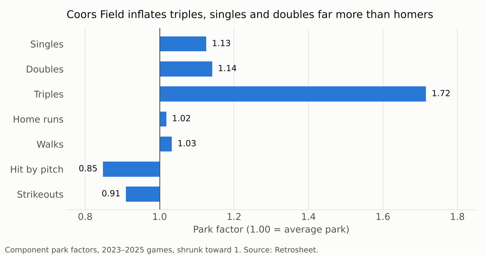
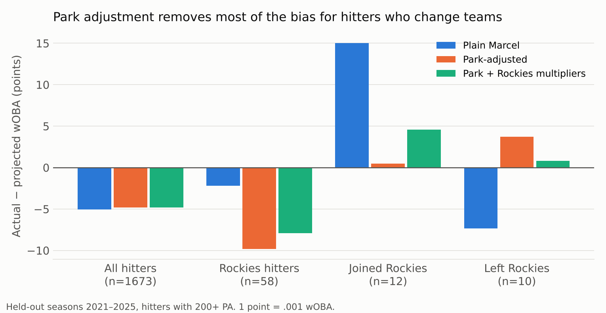

# Projecting hitters at altitude: a Coors-aware Marcel

A transparent hitter projection system, built from every regular-season plate appearance from 2012 to 2025 (about 2.46 million, from Retrosheet). It asks one question: **does handling Coors Field explicitly make projections better, and for whom?**

Three versions are compared on seasons the model never saw while it was being tuned:

| Version | What it does |
|---|---|
| **Plain Marcel** | Tom Tango's baseline: weights the last three seasons 5/4/3, regresses toward league average, adjusts for age. No park handling. |
| **Park-adjusted** | Neutralizes every past plate appearance by its park's *component* factors (singles, doubles, triples, HR, walks, HBP, strikeouts), projects in a neutral park, then places the projection back into the parks the hitter actually plays in. |
| **Park + Rockies multipliers** | Adds Rockies-specific home and road multipliers, learned from training-season errors, to capture what a generic park factor misses: the home team's extra benefit at altitude and the "Coors hangover" on the road. |

## Key findings



**1. Coors is a singles-doubles-triples park far more than a home-run park.** Using 2023–2025 games, Coors inflates triples by about 72%, singles by 13% and doubles by 14%, and cuts strikeouts by 9%. The home-run factor is only about 1.02. The big outfield and thin air reward balls in play more than fly balls over the fence, at least since the humidor. A single "runs" park factor hides this, which is why the model works component by component.



**2. Park adjustment matters most for hitters who change teams.** On held-out seasons 2021–2025:

| Group | n | Plain Marcel bias | Park-adjusted bias | Plain RMSE | Park RMSE |
|---|---|---|---|---|---|
| All hitters | 1,673 | −.0051 | −.0048 | .0319 | .0318 |
| Joined the Rockies | 12 | **+.0150** | **+.0005** | .0409 | .0375 |
| Left the Rockies | 10 | −.0073 | +.0037 | .0457 | .0418 |
| Stayed with the Rockies | 58 | −.0022 | −.0098 | .0310 | .0319 |

*Bias = actual minus projected wOBA, PA-weighted; hitters with 200+ PA.* Plain Marcel underrates hitters who move to Denver by 15 points of wOBA and overrates those who leave. Park adjustment removes almost all of that bias. The samples are small, though: the 95% bootstrap intervals on the RMSE gains include zero, so this is a strong directional signal rather than proof.

**3. The "Coors hangover" shows up, but modeling it didn't help out of sample.** On training seasons, Rockies hitters hit about 10% fewer home runs and struck out about 7% more on the road than their projections implied, beyond normal home-field effects. Adding these multipliers moved the Rockies-stayer bias in the right direction (−.0098 to −.0079), but the improvement over the park-adjusted model was within noise. One reason: for a hitter who stays in Colorado, the correction is applied both when neutralizing his past and when projecting his future, so it largely cancels.

**4. The open problem is Rockies regulars, not the park.** The park-adjusted model overprojects Rockies hitters who stay by about 10 points. The likely cause is Marcel's regression target: it pulls every hitter toward league average and then applies the full Coors boost to that average. Hitters on a rebuilding club are, as a group, below league average, so the regressed portion is too generous. Regressing toward a playing-time or role-based mean instead is the next experiment (see below).

**Context for the error numbers.** Even a perfect projection would have an RMSE of about .024 wOBA on these samples, from plate-appearance luck alone. All three models sit at about .032, so most of the remaining error is noise, not model.

## Method details

- **Data:** Retrosheet event files, 2012–2025, extracted with Chadwick's `cwevent` and `cwgame`. Rates are per wOBA plate appearance (excluding intentional walks and sacrifice bunts). wOBA uses fixed weights (BB .69, HBP .72, 1B .88, 2B 1.25, 3B 1.58, HR 2.03) so seasons are comparable.
- **Park factors:** For each park and component, the rate in games at that park divided by the rate in the host team's road games, counting both teams' plate appearances, over the prior three seasons. Shrunk toward 1 by sample size. Only data from before the target season is used.
- **Aging:** Marcel's curve, peaking at 29: +0.6% per year younger, −0.3% per year older, applied to positive outcomes (and inversely to strikeouts).
- **Tuning:** The regression amount was tuned on 2015–2019 and then frozen. It came out at 2,000 PA of league average, more than Marcel's standard 1,200. Park-factor shrinkage barely mattered. The 2020 season (60 games) is used only as input.
- **Leakage:** Every number for target season *t* comes from seasons before *t*. Rockies multipliers for the backtest were learned on 2015–2019 only.

## 2026 projections for the Rockies

`output/rockies_2026_projections.csv` projects 2026 for every hitter with 100+ PA for the 2025 Rockies: a neutral-park wOBA, a Coors home wOBA, a road wOBA, and a blended Rockies wOBA. For example, Hunter Goodman projects at .327 neutral and .336 as a Rockie, after a .358 wOBA in 2025. Marcel's regression assumes some of that breakout won't repeat.

### How they did

`src/score_2026.py` scores 2026 projections against actual 2026 lines for the 13 Rockies hitters with 100+ PA and prior MLB history, including newcomers projected as if before the season. The season repeated the backtest:

| Group (PA-weighted bias, points) | Plain Marcel | Park-adjusted | Park + Rockies |
|---|---|---|---|
| Joined Rockies (6) | +13.9 | +0.5 | +4.1 |
| Stayed with Rockies (7) | −10.1 | −16.9 | −15.1 |

Park adjustment got newcomers right on average; every version overrated returning Rockies, led by Jordan Beck (−69), Ezequiel Tovar (−52) and Brenton Doyle (−43). Actual lines come from Fox Sports' regular-season batting page, which lacks HBP and intentional walks: HBP is backed out of OBP and intentional walks are counted as walks. Rookies TJ Rumfield and Cole Carrigg had no MLB history to project from. Results: `output/rockies_2026_scored.csv`.

## Next steps

1. **Regress toward a role-based mean**, not league average: e.g. the average of hitters with similar prior playing time. This targets finding 4 directly.
2. **Re-baseline to the run environment.** All three models overproject by about 5 points league-wide, because offense fell in 2021–2025. Anchoring to the most recent season's league rates should fix most of it.
3. **Add Statcast inputs** (exit velocity, launch angle, sprint speed). Triples and singles drive Coors, so speed and spray direction should interact with the park in ways a plain multiplier misses.
4. **Pitchers.** The same component framework applies, and Coors is a bigger problem for pitcher evaluation and development.

## Running it

```bash
bash scripts/extract_retrosheet.sh     # downloads data (~160 MB) and builds Chadwick
pip install pandas numpy matplotlib
python src/backtest.py                 # tuning, backtest, 2026 projections (~1 min)
python src/charts.py                   # README charts
python src/score_2026.py               # score 2026 projections against actual 2026 lines
```

| Path | Contents |
|---|---|
| `src/data.py` | Loads plate appearances and classifies outcomes |
| `src/model.py` | Park factors, Marcel projections, Rockies multipliers |
| `src/backtest.py` | Tuning and held-out evaluation, 2026 projections |
| `src/score_2026.py` | Scores 2026 projections against actual results |
| `src/charts.py` | README charts |
| `data/rockies_2026_actual.csv` | Actual 2026 Rockies batting lines (Fox Sports) |
| `output/` | Results, projections, charts, per-player backtest predictions |
| `docs/Coors_Projections_Summary.pptx` | 8-slide summary deck (PDF copy alongside) |

## References

- Tom Tango, [Marcel the Monkey Forecasting System](https://www.tangotiger.net/marcel/)
- Tango, Lichtman & Dolphin, *The Book: Playing the Percentages in Baseball* (2007): wOBA and regression to the mean
- Jensen, McShane & Wyner, ["Hierarchical Bayesian Modeling of Hitting Performance in Baseball"](https://faculty.wharton.upenn.edu/wp-content/uploads/2009/11/Shanejensen.traj09.pdf), *Bayesian Analysis* (2009): Marcel as a benchmark
- Jim Furtado, [component park factors](https://www.baseballthinkfactory.org/btf/scholars/furtado/articles/1997parkfactors.htm)
- On the Coors hangover: [FiveThirtyEight](https://fivethirtyeight.com/features/the-rockies-have-their-worst-coors-field-hangover-yet), [Purple Row](https://www.purplerow.com/2016/2/8/10933144/colorado-rockies-coors-field-hangover-effect), [FanGraphs Community](https://community.fangraphs.com/the-coors-field-hangover-how-much-more-might-rockies-hitters-deserve/)
- wOBA weights: [FanGraphs Guts](https://www.fangraphs.com/tools/guts?type=cn)

*Data: The information used here was obtained free of charge from and is copyrighted by Retrosheet. Interested parties may contact Retrosheet at www.retrosheet.org.*
